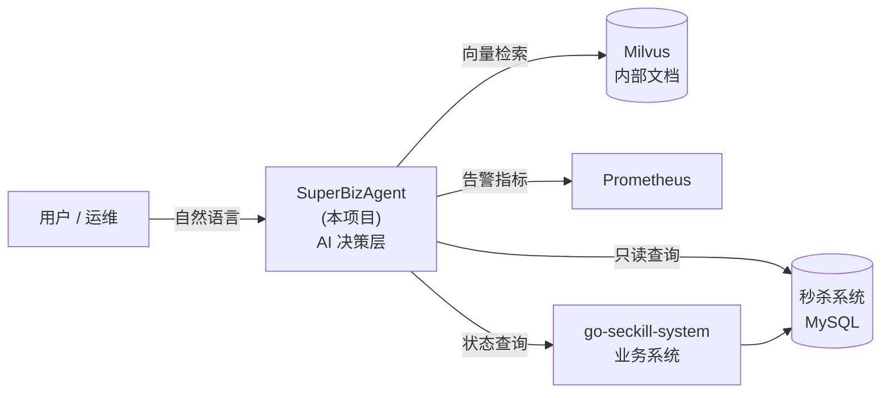
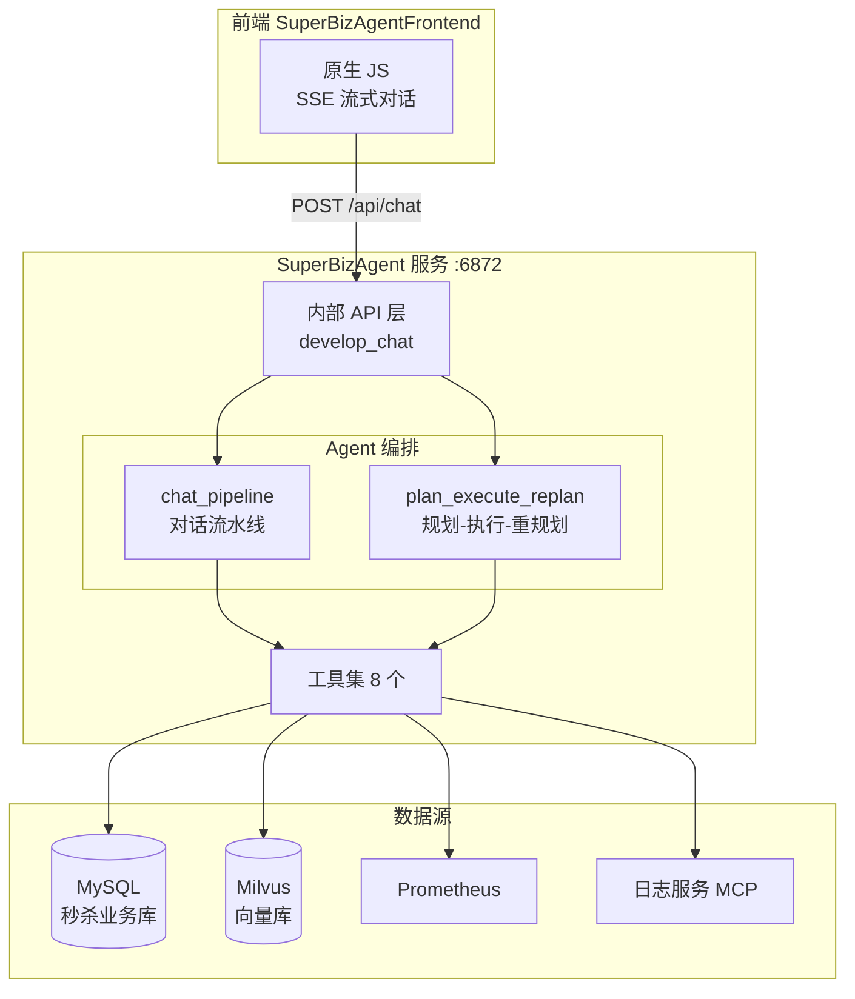
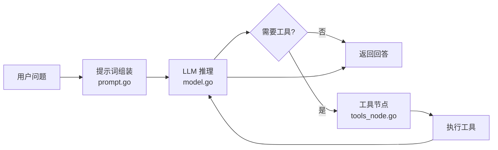

# SuperBizAgent

> 基于 **Go + Eino** 的企业级 AI Agent 服务 —— 用自然语言给秒杀系统做智能运维:查订单、看库存告警、检索内部文档、分析秒杀数据。

---

## 📚 目录

- [项目简介](#项目简介)
- [与秒杀系统的关系](#与秒杀系统的关系)
- [核心特性](#核心特性)
- [系统架构](#系统架构)
- [技术栈](#技术栈)
- [项目结构](#项目结构)
- [快速开始](#快速开始)
- [API 接口](#api-接口)
- [工具列表](#工具列表)
- [前端界面](#前端界面)
- [变更日志](#变更日志)
- [已知问题](#已知问题)
- [License](#license)

---

## 项目简介

`SuperBizAgent` 是一个面向**电商秒杀业务**的 AI 运维助手。它把 LLM、向量检索和业务数据源串成一个 Agent,让运维/运营人员用一句自然语言就能拿到答案,而不必去翻 SQL 或管理台:

> 「最近有哪些热点商品?库存告警了吗?」
> 「订单 12345 现在什么状态?」
> 「我们内部文档里对告警处理是怎么规定的?」

Agent 会自动判断该调用哪个工具——查数据库、检索知识库、还是拉 Prometheus 告警——然后把结果组织成自然语言回答。

技术上基于字节开源的 [Eino](https://github.com/cloudwego/eino) 框架构建,并实现了**两条 Agent 编排链路**:常规对话流水线,以及用于复杂任务的 Plan-Execute-Replan 模式。

---

## 与秒杀系统的关系

本项目和 [`go-seckill-system`](https://github.com/Rezarit/go-seckill-system) 是**配套的上下层关系**,不是两个独立项目:



具体来说:

- 本项目内的 `internal/seckill/` 是**针对秒杀业务域的只读数据访问层**(`config` / `dao` / `domain` / `service`),配置里的 `seckill_database` 直接指向秒杀系统的数据库
- 它**不运行**秒杀系统本身,只读取其数据来回答问题
- 知识库语料 `internal/ai/cmd/knowledge_cmd/docs/秒杀系统技术文档.md` 就是秒杀系统那份 README 的副本,被灌入 Milvus 作为 RAG 语料
- 换句话说:**秒杀系统负责交易,本项目负责"看懂"秒杀系统**

> 📌 两个仓库此前没有互链,这里补上。

---

## 核心特性

- **🤖 智能对话**:集成豆包大语言模型,支持多轮对话与上下文记忆
- **📚 RAG 文档检索**:基于 Milvus 向量数据库的内部文档语义检索,回答有据可依
- **🔧 工具调用**:Agent 自主决策调用 8 个工具(数据库查询、Prometheus 告警、秒杀业务分析等)
- **🔀 双编排链路**:常规 `chat_pipeline` + 复杂任务的 `plan_execute_replan`
- **🛡️ 优雅降级**:任一工具创建失败不影响服务启动,失败的工具会被跳过并告警
- **📝 结构化日志**:基于 Zap 的高性能日志 + 配置化的日志轮转
- **⚙️ 配置工程化**:遵循 12-Factor,环境变量可覆盖(`${VAR:-default}`),`.env` 与 `.env.example` 分离
- **💬 SSE 流式输出**:前端支持类似 ChatGPT 的逐字流式回复

---

## 系统架构

### 整体链路



### 对话流水线(chat_pipeline)



流水线包含会话历史管理、嵌入式检索(`embedding.go` / `retriever.go`)、工具节点与编排逻辑,并用 `runner.go` 在服务启动时初始化一次、后续复用。

### Plan-Execute-Replan

针对需要多步骤的复杂任务,`plan_execute_replan` 链路会把问题先**规划**成步骤(`planner.go`),逐步**执行**(`executor.go`),遇到失败或新信息时**重新规划**(`replan.go`)。

---

## 技术栈

| 分类 | 技术 | 版本 | 用途 |
|------|------|------|------|
| 语言 | Go | 1.25+ | |
| AI Agent | Eino | 0.9.2 | Agent 编排、ReAct、工具调用 |
| LLM | 豆包 | — | 对话与推理(OpenAI 兼容接口) |
| 向量数据库 | Milvus | 2.6.5 | 文档向量检索 |
| Embedding | 阿里百炼 `text-embedding-v4` | — | 文本向量化 |
| Web 框架 | Gin | 1.12.0 | HTTP 服务 |
| 日志 | Zap | 1.28.0 | 结构化日志 |
| 配置 | Viper | 1.21.0 | 配置管理 |
| ORM | GORM | 1.31.1 | 数据访问 |
| 协议扩展 | MCP | — | 日志查询工具接入 |

---

## 项目结构

```
SuperBizAgent/
├── cmd/server/main.go           # 服务入口(端口 6872)
├── config/config.go             # 配置加载 + 环境变量展开
├── config.example.yaml          # 配置模板(提交)
├── config.yaml                  # 本地配置(含密钥,.gitignore 已忽略)
├── internal/
│   ├── ai/
│   │   ├── agent/
│   │   │   ├── chat_pipeline/   # ① 对话流水线
│   │   │   │   ├── flow.go          #   主流程 + 工具注册
│   │   │   │   ├── runner.go        #   启动时初始化,复用实例
│   │   │   │   ├── model.go         #   LLM 适配
│   │   │   │   ├── embedding.go     #   向量化
│   │   │   │   ├── retriever.go     #   检索器(含 sync.Once 单例)
│   │   │   │   ├── orchestration.go #   编排
│   │   │   │   ├── tools_node.go    #   工具执行节点
│   │   │   │   ├── prompt.go        #   提示词
│   │   │   │   └── truncate_test.go #   截断工具的单测
│   │   │   └── plan_execute_replan/ # ② 规划-执行-重规划
│   │   │       ├── planner.go / executor.go / replan.go
│   │   │   ├── tools/           # 8 个工具实现
│   │   │   ├── models/          # LLM 模型适配
│   │   │   ├── embedder/        # 嵌入服务
│   │   │   ├── retriever/       # 向量检索
│   │   │   └── cmd/             # 知识库灌入 / 测试命令
│   │   ├── api/                 # 业务 API(聊天控制器)
│   │   ├── middleware/          # 中间件
│   │   └── seckill/             # 秒杀业务只读数据访问层
│   ├── api/                     # HTTP 控制器
│   └── seckill/                 # 秒杀域 config / dao / domain / service
├── SuperBizAgentFrontend/       # 原生 JS 前端(无框架、零依赖)
├── manifest/docker/             # Docker 部署(milvus / etcd / minio / mysql)
├── docs/changelogs/             # 工程变更日志(3 篇)
└── test/ utility/               # 测试与工具
```

---

## 快速开始

### 环境要求

| 依赖 | 版本 |
|------|------|
| Go | 1.25+ |
| Milvus | 2.6+ |
| MySQL | 5.7+ |
| Docker | 用于拉起依赖服务 |

### 1. 启动依赖服务

```bash
cd manifest/docker
docker compose up -d
```

会拉起 Milvus(含 etcd、MinIO)与 MySQL。端口通过 `${VAR:-default}` 环境变量化,可按需覆盖(参考同目录 `.env.example`)。

### 2. 配置

```bash
cp config.example.yaml config.yaml
```

编辑 `config.yaml`,至少填写以下各项:

| 配置项 | 说明 |
|--------|------|
| `doubao_think_chat_model.api_key` | 豆包推理模型 API Key |
| `doubao_quick_chat_model.api_key` | 豆包快速模型 API Key |
| `doubao_embedding_model.api_key` | 向量化模型 API Key |
| `seckill_database.*` | 秒杀系统数据库连接(host / port / user / password / dbname) |
| `prometheus.url` | Prometheus 地址(使用告警工具时) |

> ⚠️ `config.yaml` 已在 `.gitignore` 中,**请勿提交**。仓库只提交 `config.example.yaml` 模板。

### 3. 启动服务

```bash
go run ./cmd/server/main.go
```

服务监听 **`:6872`**,同时会挂载前端静态页面。启动日志形如:

```
[Main] 步骤1/3: 初始化配置和日志系统...
[Main] 步骤2/3: 初始化 Chat Agent...
[Agent] 注册工具: prometheus_alerts_query
...
[Main] ========== HTTP Server Started Successfully on :6872 ==========
```

### 4. 访问

浏览器直接打开 **http://localhost:6872/** 即可使用前端界面。

命令行验证:

```bash
# 健康检查
curl http://localhost:6872/api/info

# 对话
curl -X POST http://localhost:6872/api/chat \
  -H "Content-Type: application/json" \
  -d '{"message": "你好"}'
```

---

## API 接口

### `POST /api/chat`

智能对话接口。

**请求体**:

```json
{
  "message": "查询内部文档",
  "history": []
}
```

**响应**:

```json
{
  "code": 200,
  "message": "success",
  "data": {
    "reply": "这是查询结果...",
    "tool_used": "query_internal_docs"
  }
}
```

### `GET /api/info`

服务信息接口。

```json
{
  "message": "SuperBizAgent API",
  "version": "1.0.0"
}
```

---

## 工具列表

Agent 可自主调用的工具。⚠️ 下表已按**代码实际注册情况**核对——原 README 有过时信息,此处修正。

| 工具 | 功能 | 注册状态 |
|------|------|----------|
| `query_internal_docs` | **内部文档 RAG 检索** — 获取 retriever 并在 Milvus 中做向量检索 | ✅ 已注册 |
| `get_current_time` | 返回秒/毫秒/微秒时间戳 + 可读格式 | ✅ 已注册 |
| `prometheus_alerts_query` | **Prometheus 活动告警查询** — alertname / state / activeAt / labels 等 | ✅ 已注册 |
| `seckill_query_products` | 秒杀商品查询 — 按 product_id / keyword | ✅ 已注册 |
| `seckill_query_orders` | 秒杀订单查询 — 按 order_id / user_id / status,支持分页 | ✅ 已注册 |
| `seckill_analyze_data` | 秒杀数据分析 — `hot_products` / `stock_alert` / `all` | ✅ 已注册 |
| `query_log`(MCP) | 通过 **MCP 协议**连接日志服务(腾讯云 CLS) | ⚠️ 条件注册 —— 依赖的托管 MCP 已下架,当前会跳过 |
| `mysql_crud` | 通用 SQL 执行 | ❌ **未注册** —— 代码中已标注弃用(生产环境不宜直接执行任意 SQL) |

> 说明:`flow.go` 中的注册采用**安全注册模式**,工具创建失败只记录 Warn 并跳过,不影响服务启动——这就是「优雅降级」。

---

## 前端界面

`SuperBizAgentFrontend/` 是一个**手写的原生 JS 前端**(`app.js` 约 52 KB,无任何前端框架依赖),由后端在 `http://localhost:6872/` 直接托管。

功能包括:

- 普通对话与 **SSE 流式对话**(逐字输出,类似 ChatGPT)
- 左侧会话列表 / 新建对话
- 拖拽或点击上传文件到知识库(PDF / TXT / MD / CSV / DOC / DOCX)

本地单独起前端调试:

```bash
cd SuperBizAgentFrontend
./start.sh          # 依次尝试 python3 / python / node 起静态服务器
```

> ⚠️ **已知不一致**:前端 `app.js` 调用了 4 个端点(`/chat`、`/chat_stream`、`/upload`、`/ai_ops`),而后端 `cmd/server/main.go` 目前**只注册了 `/api/chat` 和 `/api/info`**。因此流式对话、文件上传、AI Ops 这三个功能在当前代码下**实际不可用**,属于待补齐的接口。普通对话可正常使用。

---

## 变更日志

本项目的工程化过程有完整记录,建议按顺序阅读——这三篇比 README 更能体现工程能力:

| 文档 | 内容 |
|------|------|
| [chat-pipeline-bugfix](./docs/changelogs/2026-08-08-chat-pipeline-bugfix.md) | 修复主链路 6 个缺陷:按**字节**截断导致中文乱码(改 `truncateByRune`)、DB 断连无法恢复、`sync.Once` 被重置违反 Go 语义、请求无超时导致 goroutine 泄漏、**同 session 并发请求历史互相覆盖**、清理死函数 |
| [bugfix-verification](./docs/changelogs/2026-08-08-chat-pipeline-bugfix-verification.md) | 上述修复的验证测试报告,含测试环境与逐 case 结果 |
| [config-env-ports](./docs/changelogs/2026-08-08-config-env-ports.md) | 配置工程化:`docker-compose` 端口环境变量化、`.env` 提交策略、Windows Hyper-V 保留端口段导致服务无法绑定的排查 |

---

## 已知问题

| 问题 | 说明 |
|------|------|
| **前端三功能不可用** | `/api/chat_stream`、`/api/upload`、`/api/ai_ops` 前端已实现、后端未注册路由 |
| **CI 未运行** | `.github/workflows/go.yml` 触发分支写的是 `main`,而仓库默认分支是 `master`,导致 workflow 从未被触发 |
| **`query_log` 依赖失效** | 腾讯云托管 MCP 已下架,该工具当前会被跳过 |
| **默认分支名** | 默认分支为 `master`(非 `main`),克隆后注意 |
| **`config.yaml` 曾误提交** | 含密钥的本地配置曾被提交,`.gitignore` 对已跟踪文件无效——已处理,密钥需轮换 |

---

## License

[MIT](./LICENSE)
